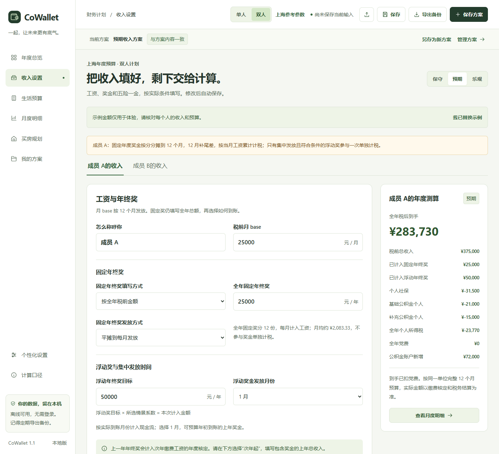
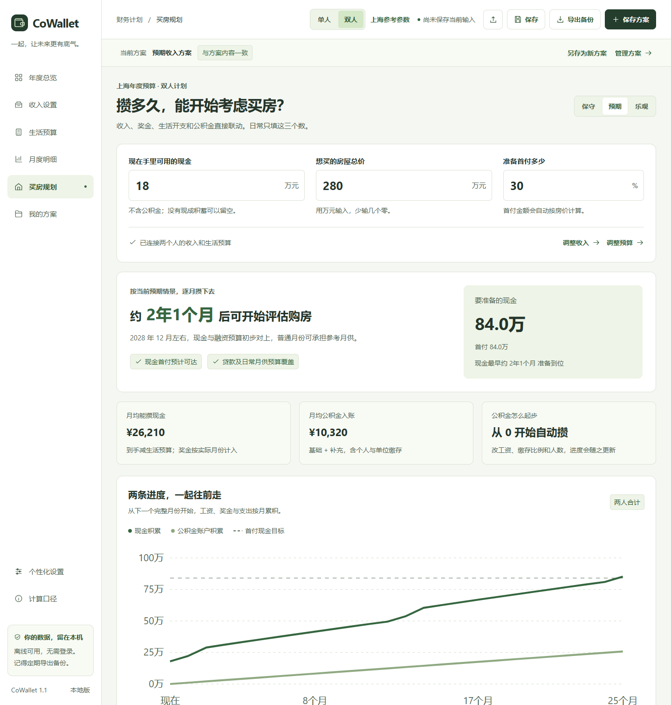
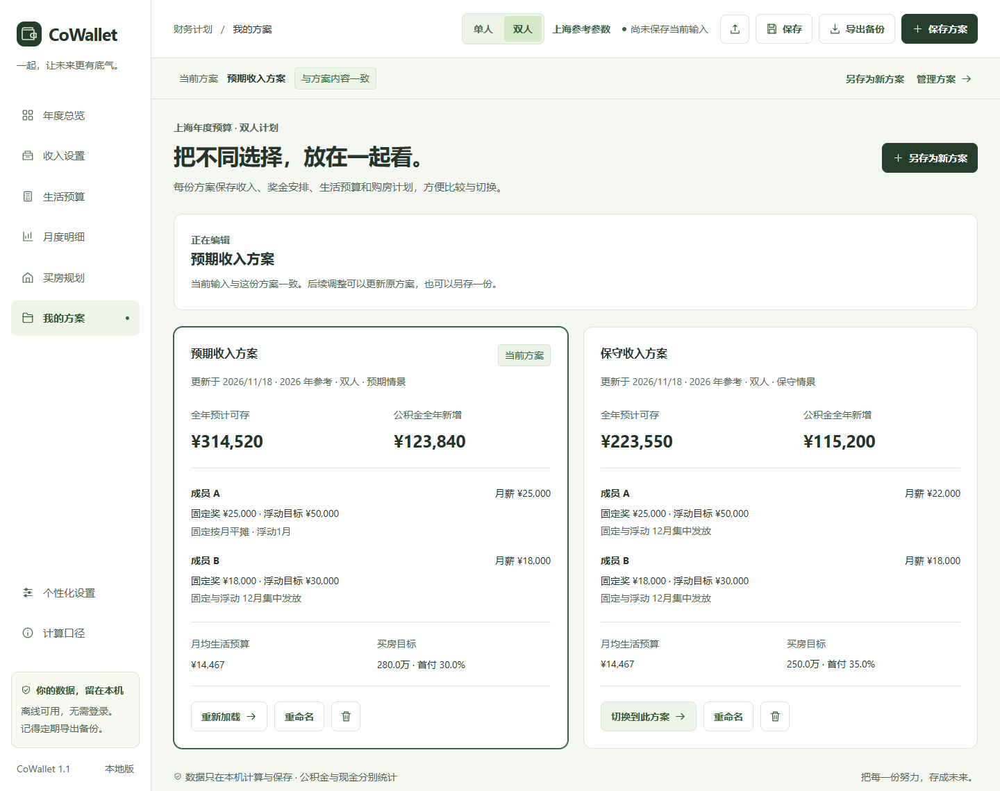

# CoWallet

**在本机算清一个人或两个人的收入、生活开支，以及一年能存多少钱。**

CoWallet 是面向上海工资薪金场景的本地网页工具。可以比较不同 Offer、安排共同生活预算，也能估算要攒多久才够首付。现金与公积金分别统计，修改收入或预算后，购房进度会随之更新。

**v1.1 · 无需安装 · 无需登录 · 离线可用**

[下载与版本说明](https://github.com/Suryxin-xx/CoWallet/releases) · [快速使用](#快速使用) · [计算与开发参考](docs/REFERENCE.md) · [问题反馈](https://github.com/Suryxin-xx/CoWallet/issues) · [MIT License](LICENSE)


> 本页截图及首次使用时的默认数据全部为虚构示例，请替换为自己的收入和预算。

## 下载与打开

1. 前往 [GitHub Releases](https://github.com/Suryxin-xx/CoWallet/releases)，下载 `CoWallet-1.1-windows.zip`；版本变化以对应 Release 说明为准。
2. 将完整 ZIP 解压到一个固定目录，不要在压缩包内直接运行。
3. Windows 可双击 `打开CoWallet.cmd`；也可以直接用 Edge、Chrome 等现代浏览器打开 `index.html`。
4. 首次使用请替换示例中的收入和预算；已有数据的用户，升级前请先导出 JSON 备份。

网页本身也可在 macOS、Linux 的现代浏览器中直接打开 `index.html`，Windows 启动脚本不适用于这些系统。正常使用不需要 Node.js 或本地服务器。

下载区附有 `CoWallet-1.1-windows.zip.sha256`。在 Windows PowerShell 计算 ZIP 的 SHA-256，核对是否与校验文件一致。

```powershell
Get-FileHash .\CoWallet-1.1-windows.zip -Algorithm SHA256
```

## 能做什么

| 功能 | 说明 |
| --- | --- |
| 单人与双人预算 | 分别计算两个人的收入与税款，再汇总现金结余；切换人数保留第二人的输入 |
| 工资与年终奖 | 月 base、固定奖金额或月薪倍数、浮动奖及保守／预期／乐观情景；固定奖可集中发放或按月均摊 |
| 社保、公积金与党费 | 支持月薪参考、历史年收入月均、共用核定基数或分别核定；基础／补充公积金区分个人与单位 |
| 个税与到手 | 累计预扣、专项附加扣除、符合条件的全年一次性奖金单独／合并计税比较 |
| 生活预算 | 房租、三餐、交通等自定义项目；共同与个人支出、月支出与年度一次性支出、共同费用分摊 |
| 存款与购房进度 | 月度／年度现金结余、公积金新增；联动首付准备时间、贷款组合及买后月供预算 |
| 多套方案 | 保存、加载、更新、另存、重命名和删除；明确当前方案及相对快照的修改状态 |
| 外观与导出 | 五套浅色主题、字号与显示栏目；JSON 备份恢复、CSV 月度明细导出 |

## 界面预览

<table>
  <tr>
    <td width="50%"><strong>收入与奖金安排</strong></td>
    <td width="50%"><strong>存钱与购房进度</strong></td>
  </tr>
  <tr>
    <td></td>
    <td></td>
  </tr>
</table>



## 快速使用

1. **填写收入。** 选择单人或双人，录入各人的税前月薪、固定奖和浮动奖，确认缴费基数、比例与扣除项目。固定奖按全年总额填写；选择按月均摊时，系统将总额分配至 12 个月。
2. **安排预算。** 录入共同房租、三餐、交通等，以及各自的个人开支。共同费用只扣一次，分摊方式影响个人结余，不改变双人总支出。
3. **查看结余。** 切换奖金情景，查看年度、月均或具体月份的到手与结余。现金预计可存为到手减生活预算；公积金新增包含个人及单位缴存，单独展示。
4. **保留方案。** 点击“保存方案”建立独立快照。后续编辑会自动保存当前草稿；“更新此方案”才覆盖已关联快照，“另存为新方案”会保留原方案。
5. **继续做购房预算。** 填写已有现金、目标房价和首付比例，查看逐月积累。金额输入标有“万元”时按万元填写，其他金额按页面单位填写；高级设置可补充已有公积金余额、费用、备用金与贷款条件。

每个人各选一个发奖月份。固定奖集中发放时，两笔奖金在同一月到账。固定奖按月均摊时，该月份只决定浮动奖何时到账，均摊的固定奖随工资计税，符合条件的浮动奖可参与单独计税比较。 [奖金计算参考](docs/REFERENCE.md#奖金如何入账)

## 本地数据、备份与更新

- **数据保存在浏览器。** 当前输入、方案及外观偏好使用本机浏览器存储，不会写回应用源码，也不会上传服务器。主动点击政策来源链接时，会打开外部官网。
- **JSON 用于恢复，CSV 用于查看。** JSON 备份包含薪资、预算、方案及相关设置，可能包含已有现金和公积金余额；文件没有加密，请保存在私人位置。CSV 是计算结果明细，不能替代可编辑方案备份。
- **升级或换设备前先备份。** 隐私模式、清理浏览器数据、更换浏览器、移动文件位置，都可能影响原有记录的读取。先导出 JSON，再解压新包并打开；如未找到旧数据，主动导入备份。不要为升级先清空浏览器数据。
- **本地版与发行版分开保存。** 发行包使用独立的存储命名空间，不会自动读取源码本地版的记录；需要迁移时可主动导入 JSON。这是渠道隔离，不是加密，也不是同一浏览器内多个用户的账户隔离。
- **分享源码与分享个人文件要分开。** 发行脚本按白名单收集应用文件、公开文档、虚构截图与测试，不读取浏览器中的方案。私人 JSON／CSV、自己截取的页面图片及诊断文件可能包含个人信息，不应上传到公开仓库。`.gitignore` 不能保护已经被 Git 跟踪或主动加入的文件。

## 计算范围

- 当前主要适用于上海、中国大陆居民个人、同一单位完整工作 12 个月的工资薪金预算。两个人分别计税；入离职、年中换工作、多处所得及实际汇算不在完整模拟范围内。
- 政策参数不会自动联网更新，最近核验日期为 **2026-11-17**。运行年份自动读取；后续年份的参考参数与适用提醒、手动设置方式见[计算与政策参考](docs/REFERENCE.md)。预算结果需与单位核定、工资条和实际税务结算核对。
- 历史年收入用于核定缴费基数，不会被今年的奖金情景反向改写；年终奖发放当月也不会额外重复加缴一遍五险一金。
- 公积金账户新增不等于可用现金，也不会自动加入首付。购房进度从下一个完整月份开始，按当前收支结构推演，不预测涨薪、投资收益、房价或政策变化。
- “可开始评估购房”表示现金及融资预算初步匹配，并检查常规月份的月供压力；不代表贷款资格或审批承诺。双人收支不自动等于符合共同借款资格；本版不模拟公积金首付提取或冲还贷。

## 常见问题

| 情况 | 处理方式 |
| --- | --- |
| 修改后显示“有修改”，是否没有保存？ | 当前草稿仍会自动保存；这个状态表示它与已存方案快照不同。要覆盖快照，请点“更新此方案”。本机写入失败会单独提示。 |
| 旧备份导入后没有“当前方案” | 旧版没有记录方案关联，不会自动猜测。加载需要的方案后即可建立关联。 |
| 改了浮动奖金，缴费基数为什么没变？ | 已填写的历史年收入或单位核定基数会保留。本年奖金情景只改变当前收入测算，不改写历史事实。 |
| 切成单人后，第二人的数据还在吗？ | 仍然保留，只暂时不计入收入与个人支出；切回双人即可继续使用。 |

## 开发

使用原生 HTML、CSS 和 JavaScript，无前端构建步骤。开发入口为 `index.html`；收入计算在 `engine.js`，购房测算在 `mortgage.js`，界面在 `app.js`，外观偏好在 `preferences.js`。

已安装 Node.js 时，在项目目录可运行下面的本地检查。它们使用虚构输入，不联网，也不读取个人方案：

```powershell
node .\tests\engine.test.cjs
node .\tests\mortgage.test.cjs
node .\tests\planning-integration.test.cjs
node .\tests\preferences.test.cjs
node .\tests\plans.test.cjs
node .\tests\package-release.test.cjs
```

详细计算口径、政策来源、兼容规则及打包方法见[计算与开发参考](docs/REFERENCE.md)。

## 反馈与开源协议

欢迎通过 [GitHub Issues](https://github.com/Suryxin-xx/CoWallet/issues) 提交问题或建议。计算问题请附版本、操作步骤、预期与实际结果，并使用脱敏或虚构数值；不要公开上传个人备份。

项目地址：[Suryxin-xx/CoWallet](https://github.com/Suryxin-xx/CoWallet)。本项目基于 [MIT License](LICENSE) 开源。
